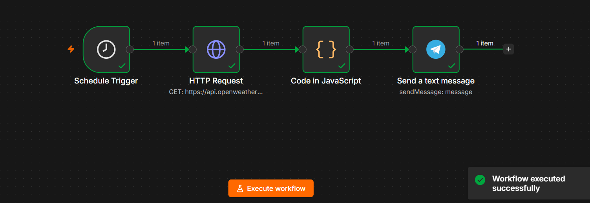
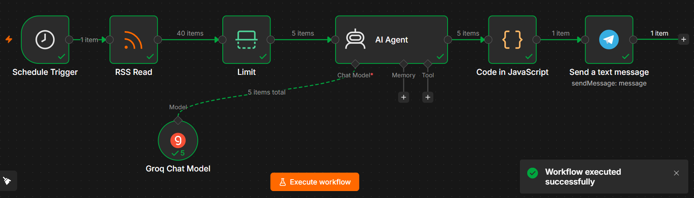
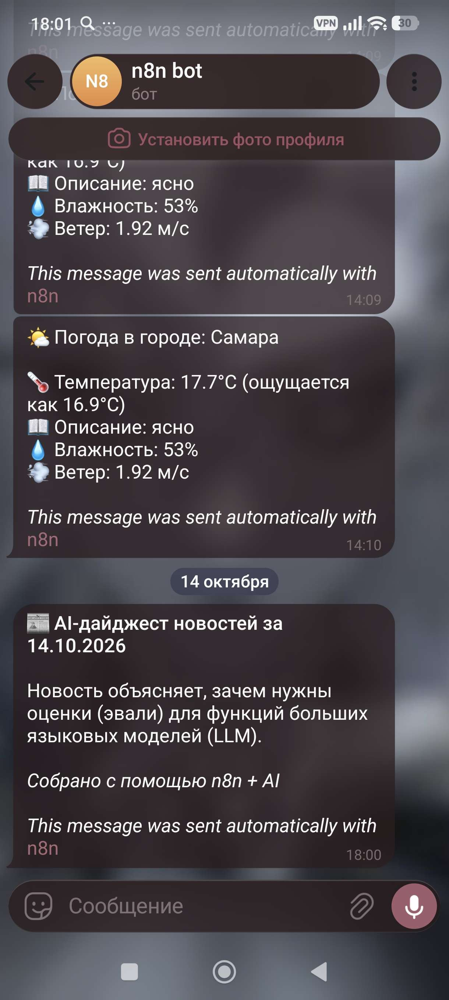

# n8n Automation Projects

Коллекция автоматизаций на платформе [n8n](https://n8n.io/): Telegram-бот с прогнозом погоды и AI-дайджест новостей.

## Демонстрация

| 1. Схема погодного бота | 2. Схема AI-дайджеста | 3. Результат в Telegram |
|:---:|:---:|:---:|
|  |  |  |

## Возможности

### 1. Weather Bot (`workflows/weather-bot.json`)
- **Расписание:** запуск по `Schedule Trigger` (каждый день в 9 утра по МСК, можно изменить на любое время).
- **Получение данных:** `HTTP Request` к API OpenWeatherMap (текущая погода в Самаре).
- **Форматирование:** `Code in JavaScript` — сборка красивого сообщения (температура, описание, влажность, ветер).
- **Отправка:** `Telegram Send Message` — сообщение приходит в личный чат с ботом.

### 2. AI News Digest (`workflows/ai-news-digest.json`)
- **Расписание:** запуск по `Schedule Trigger` (каждый день в 9 утра по МСК, можно изменить на любое время).
- **Источник:** `RSS Read` — чтение ленты Habr (можно заменить на любой RSS).
- **Ограничение:** `Limit` — берём только 5 свежих статей.
- **AI-обработка:** `AI Agent` (Groq Chat Model) — выбирает 3 главные новости и пишет краткое резюме.
- **Форматирование:** `Code in JavaScript` — добавляет заголовок и дату.
- **Отправка:** `Telegram Send Message` — готовый дайджест приходит в Telegram.

## Архитектура

Оба workflow используют стандартную схему n8n: триггер → получение данных → обработка → отправка.

### Weather Bot

Schedule Trigger → HTTP Request (OpenWeatherMap) → Code (JS) → Telegram

### AI News Digest

Schedule Trigger → RSS Read → Limit → AI Agent (Groq) → Code (JS) → Telegram


### Используемые узлы
- `Schedule Trigger` — запуск сценария.
- `HTTP Request` — запрос к внешнему API.
- `RSS Read` — чтение RSS-ленты.
- `Limit` — ограничение количества элементов.
- `AI Agent` — работа с LLM (Groq Chat Model).
- `Code` — обработка данных на JavaScript.
- `Telegram` — отправка сообщений.

## Технологии

- **n8n** (Community Edition, запуск через `npx n8n`)
- **Telegram Bot API**
- **OpenWeatherMap API**
- **Groq API** (модель `openai/gpt-oss-20b`)
- **JavaScript** (в узле Code)
- **Cloudflare WARP** (для обхода блокировок при работе с Telegram и внешними API)

## Установка и запуск

1. **Установите n8n:**
   ```bash
   npx n8n

   или глобально:

   npm install -g n8n
   n8n start

2. **Импортируйте workflow:**

   - Откройте n8n (http://localhost:5678).
   - В меню слева выберите Workflows → Import from File.
   - Загрузите weather-bot.json или ai-news-digest.json.

3. **Настройте credentials:**

   - Telegram: создайте бота через @BotFather, получите токен и вставьте в узел Telegram.
   - OpenWeatherMap: зарегистрируйтесь на openweathermap.org, получите API-ключ и вставьте в URL HTTP Request.
   - Groq: зарегистрируйтесь на console.groq.com, получите API-ключ и подключите к узлу Groq Chat Model.

4. **Запустите workflow:**

   - Нажмите Execute workflow для ручного теста.
   - Для автоматического запуска по расписанию нажмите Publish (или Active).

**Примечания**
- Для работы Telegram и внешних API может потребоваться VPN (мною использовался Cloudflare WARP).
- API-ключи и chat_id не хранятся в репозитории — настройте их локально в n8n.
- RSS-источник в AI-дайджесте можно заменить на любой другой (например, новости Python, AI, IT).

**Лицензия**
MIT — свободное использование с указанием авторства.
